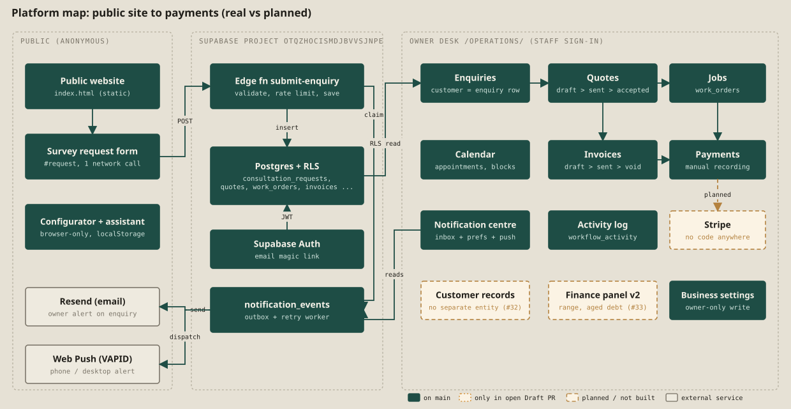
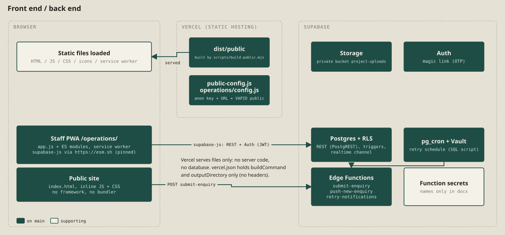
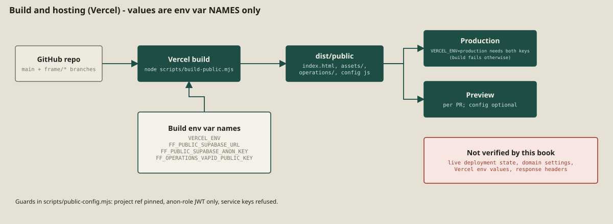
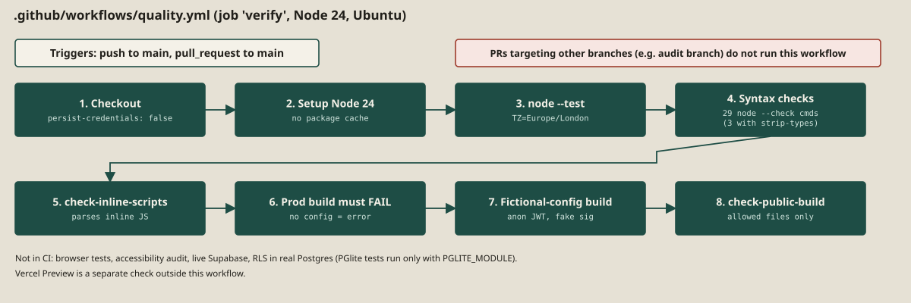
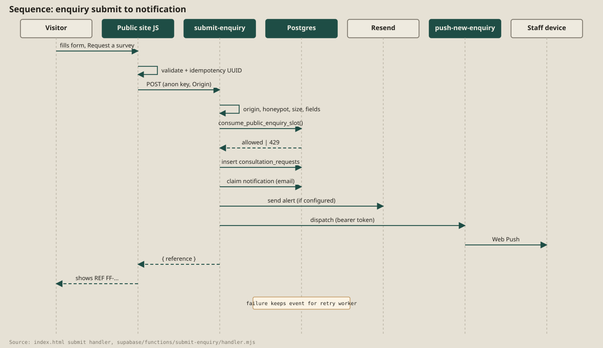
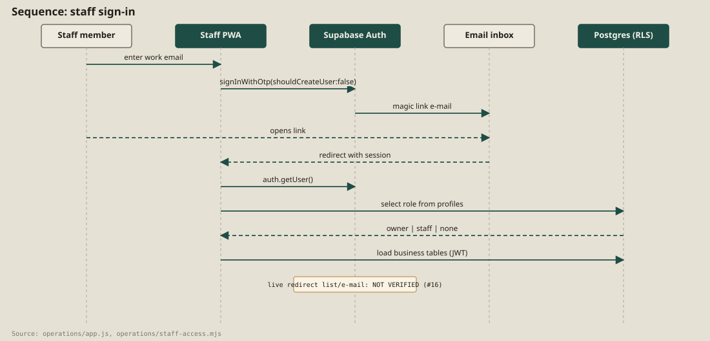
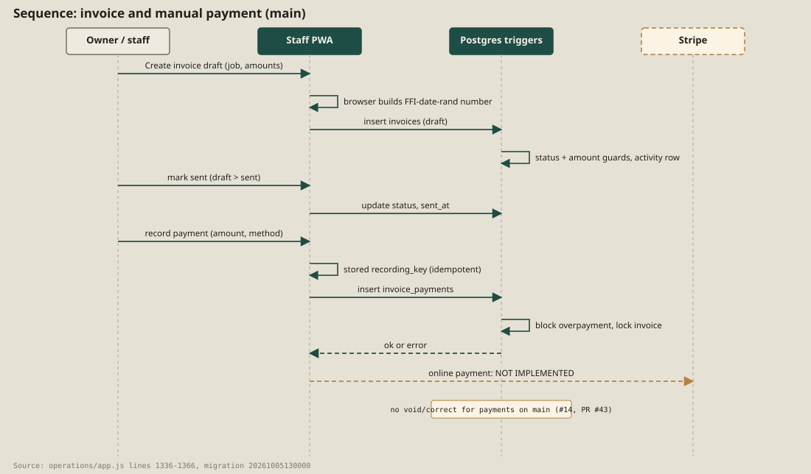
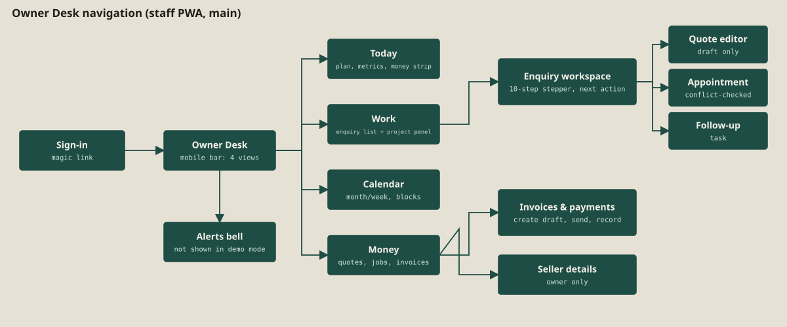

# 2. Platform map and architecture

## 2.1 The platform on one page

Form & Frame is a **static website plus a static staff web-app (PWA), both served by Vercel, talking directly to one Supabase project** (`otqzhocismdjbvvsjnpe`, pinned in `scripts/public-config.mjs` and `supabase/config.toml`). There is no application server, no framework and no bundler: `index.html` has inline CSS and JavaScript, and `/operations/` is plain ES modules. [E-21] [E-18]

The chain the owner asked about, with its real status on `main`:

| Link | Status on `main` | Notes |
|---|---|---|
| Public site to form | [[VERIFIED]] UI observed; validation messages screenshot | The form is the only network call from the public site (one `fetch`, `index.html:2837`). [E-05] |
| Form to backend (Edge Function) | [[VERIFIED]] by 27 offline handler tests | Not observed live: the live Supabase project was not contacted. |
| Backend to Supabase DB | [[IMPLEMENTED]] | Migrations exist; the live schema state is not verified (see [pending](pending-confirmation.md)). |
| DB to Owner Desk | [[IMPLEMENTED]] | Staff PWA reads through supabase-js with the staff JWT and RLS. |
| Owner Desk: enquiries to quotes to jobs to invoices to payments | [[IMPLEMENTED]] | Pure logic is VERIFIED by tests; the screens need a live login and are **not verifiable** here. |
| Clients | [[PARTIAL]] | There is **no separate customer entity**: the customer is the enquiry row (`consultation_requests`). Issue #32. |
| Notifications | [[IMPLEMENTED]] | Internal alert e-mail (Resend), Web Push, an in-app notification centre; no customer-facing messages. |
| Online payments (Stripe) | [[NOT IMPLEMENTED]] | Only a `stripe` value in a column check. [E-17] Design in Draft PR #25. |

## 2.2 Front end and back end

- **Hosting**: `vercel.json` on `main` has only `buildCommand` and `outputDirectory`; **no response headers (no CSP)** are configured. [E-23]
- **Build**: `node scripts/build-public.mjs` copies `index.html`, `assets/` and an explicit list of `operations/` files into `dist/public/` and writes two generated config files (`public-config.js`, `operations/config.js`) that contain only the public Supabase URL, the anon key and the public VAPID key. A production build **fails** if the keys are missing. [E-21]
- **Third-party loads at runtime** (browser): `https://esm.sh/@supabase/supabase-js@2.117.2` (unvendored, no SRI; staff app and Edge Functions), `fonts.googleapis.com` / `fonts.gstatic.com`. [E-24] [E-26]

## 2.3 Vercel and CI/CD

The workflow runs only for pushes to `main` and for pull requests **targeting `main`**; PRs aimed at other branches get no CI. [E-22] Vercel Preview/Production behaviour is **not verified** in this book.

## 2.4 Page-by-page map

There are exactly two user-facing pages on `main`: the public site and the staff app. Other HTML files in the repo (`anthony-roadmap.html`, `owner-desk-approval-preview.html`, `docs/MASTER_DOCUMENTATION.html`) are not copied by the build and are not routes. [E-21]

### Route `/` — Public website (`index.html`)

| Item | Detail |
|---|---|
| Purpose | Marketing and enquiry: configurator, process, works, request form. |
| Sections (anchors) | `#drawing`, `#survey`, `#specify`, `#process`, `#works`, `#testimonials`, `#request`, footer. [E-04] |
| Interactive elements | Nav links (4) + **Staff access** + **Book a survey**; hero zoom/pan controls (−, +, rotate, maximise, fit); survey/proposal comparison slider; configurator (budget mode, wall/ceiling, left/right bays, module/unit sizes, finish, texture, glass, fronts, handles, TV, fire, lighting, room-photo overlay); Save/Share spec; Send with survey; enquiry form (name, phone-or-email, postcode, wall width, brief, optional visit window); project assistant chat (3 suggestion chips + free text); final-brief dialog (email draft, copy, download .txt). |
| Button destinations | Nav links scroll to anchors. **Staff access** goes to `https://form-and-frame.vercel.app/operations/` (external, `index.html:686`). **Book a survey** scrolls to `#request`; "Send with survey" copies the configured spec into the brief field and scrolls to `#request` (`index.html:2270-2278`). The form submits to `POST {supabaseUrl}/functions/v1/submit-enquiry`. "Open email app" uses a `mailto:` link with no recipient. [E-05] |
| Backend actions | One: `submit-enquiry`. The assistant is rule-based in the browser (no `fetch`); the saved spec lives in `localStorage` (`ff_spec`). [E-05] |
| Roles | Anonymous. |
| Status | [[VERIFIED]] UI shell and validation observed; [[IMPLEMENTED]] live submit (not observed live). |
| Dependencies | Google Fonts; `/public-config.js` (generated at build); Supabase project. |

### Route `/operations/` — Staff app "Owner Desk" (`operations/index.html`, `app.js`)

| Item | Detail |
|---|---|
| Purpose | Private desk for the team: enquiries, quotes, jobs, calendar, invoices, payments, notifications. |
| States | (a) **Sign-in** (magic link) when a Supabase config is present; (b) **Demo mode** with fictional data when no config is present (a build without `config.js`); (c) **Owner Desk** after a verified staff sign-in; (d) enquiry workspace overlay; (e) notification panel. |
| Navigation | Desktop: left sidebar Today / Enquiries / Calendar / Money. Phone: fixed bottom bar Today / Work / Calendar / Money. |
| Button destinations | Sidebar items link to `#desk`, `#leads`, `#availability`, `#business` (**`#desk` does not exist in the HTML**, so the Today link does not jump anywhere; minor). Brand and badge link to `../index.html`. Open (enquiry) opens the workspace; Alerts opens the notification panel; Sign out calls `auth.signOut()` then reloads. |
| Backend actions | Reads: `consultation_requests`, `quotes`, `work_orders`, `appointments`, `follow_up_tasks`, `invoices` (+ `invoice_balances`), `invoice_payments`, `workflow_activity`, `business_settings`, `notification_events`, `push_subscriptions`. Writes: see [Owner Dashboard](owner-dashboard.md). Calls `push-new-enquiry` for test/dispatch. Realtime channel `ff-operations` listening to row changes on ten tables including `profiles`. [E-10] |
| Roles | `owner` and `staff` (from `profiles.role`); an authenticated user without a profile sees "not added to the team". Owner-only: invoice seller details. |
| Status | Sign-in screen and demo mode [[VERIFIED]] (observed); signed-in desk [[IMPLEMENTED]], not verifiable here. |
| Dependencies | esm.sh (supabase-js), Google Fonts, Supabase Auth/PostgREST/Realtime, service worker for push. |

### Generated and static files

| Path | Purpose |
|---|---|
| `/public-config.js`, `/operations/config.js` | Generated at build: URL, anon key, public VAPID key only. |
| `/operations/manifest.webmanifest`, `/operations/service-worker.js` | PWA install and Web Push handling. |
| `/assets/cases/*.webp` | Eight before/after photographs for the "Completed works" section. |
| `/robots.txt`, `/sitemap.xml` | **Not on main** (added in PR #8). |

## 2.5 Sequence: enquiry submit to notification

## 2.6 Sequence: staff sign-in

## 2.7 Sequence: invoice and manual payment

## 2.8 Owner Desk navigation

