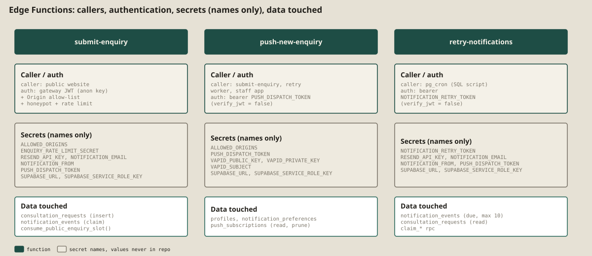
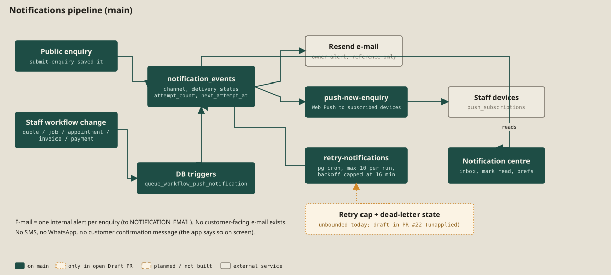
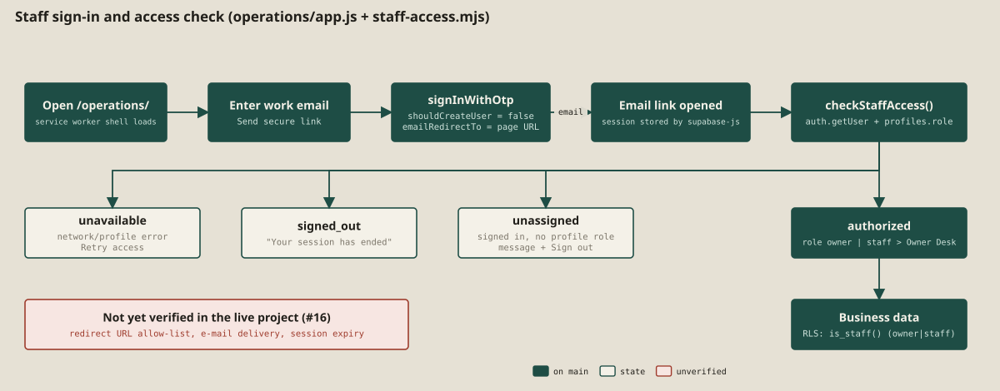

# 5a. Backend

The backend is a Supabase project plus three Edge Functions written in TypeScript/JavaScript for Deno. All handler logic lives in plain `.mjs` files with injected dependencies so that it can be tested offline. **There is no other server code.**

## Edge Functions (`supabase/functions/`)

| Function | Caller | Authentication (`supabase/config.toml`) | Purpose |
|---|---|---|---|
| `submit-enquiry` | Public website | `verify_jwt = true` (the anon key satisfies the gateway) plus handler checks: Origin must be on `ALLOWED_ORIGINS` (403 otherwise), POST only, 32 KB body cap, honeypot `company_website`, UUID idempotency key, field validation, 12 KB project-spec cap | Validates and saves an enquiry, rate-limits it, claims a notification event and sends the owner alert e-mail and push dispatch. Returns `{ reference }`. |
| `push-new-enquiry` | `submit-enquiry`, the retry worker, the staff app | `verify_jwt = false`; handler requires `Authorization: Bearer <PUSH_DISPATCH_TOKEN>` | Sends Web Push to subscribed staff devices honouring each user's notification preferences; prunes expired subscriptions. |
| `retry-notifications` | `pg_cron` via a SQL script (not applied by migrations) | `verify_jwt = false`; handler requires `Bearer <NOTIFICATION_RETRY_TOKEN>` compared in constant time | Processes at most 10 due events per run; exponential backoff capped at 16 minutes; recovers expired claims. |

**Secrets** are referenced by **name only** in this book: `ALLOWED_ORIGINS`, `ENQUIRY_RATE_LIMIT_SECRET`, `RESEND_API_KEY`, `NOTIFICATION_EMAIL`, `NOTIFICATION_FROM`, `PUSH_DISPATCH_TOKEN`, `NOTIFICATION_RETRY_TOKEN`, `VAPID_PUBLIC_KEY`, `VAPID_PRIVATE_KEY`, `VAPID_SUBJECT`, `SUPABASE_URL`, `SUPABASE_SERVICE_ROLE_KEY`. They are set as Supabase Function Secrets (and the retry token in Vault); none is in the repository. Whether they are set in the live project is **not verified**. [E-19]

### How an enquiry is accepted (`submit-enquiry/handler.mjs`)

1. CORS: preflight allowed only for allowed origins; other origins receive 403.
2. Parse JSON (413 if too large; 400 if invalid); a filled honeypot returns a generic 400.
3. Validate: UUID idempotency key, name 2+ chars, postcode, at least one of e-mail/phone, valid e-mail shape, timestamps, project spec size (422 on failure).
4. Require server configuration (`SUPABASE_URL`, service-role key, a 32+ character `ENQUIRY_RATE_LIMIT_SECRET`) or fail closed with 503.
5. Look up the idempotency key first: a repeat returns the saved reference and continues delivery; otherwise hash the client address with HMAC-SHA-256 and call `consume_public_enquiry_slot` (returns allowed, or 429 with `Retry-After`).
6. Insert into `consultation_requests`; on a unique-index race, reconcile by idempotency key.
7. Claim the e-mail notification (`claim_new_enquiry_notification`, a row-locked RPC), send via Resend if `RESEND_API_KEY`, `NOTIFICATION_EMAIL`, `NOTIFICATION_FROM` are set, record the outcome; then dispatch push using `PUSH_DISPATCH_TOKEN`. A delivery failure never loses the enquiry: the event stays retryable.

Tested by 27 tests in `handler.test.mjs` (CORS, size, honeypot, validation, idempotency, rate limit, failure paths). **Not tested:** the deployed function on Deno, the real Resend API, real cron. [E-18]

## Notification delivery

- **Outbox.** `notification_events` stores channel (`email`, `push`, `webhook`), event type, JSON payload (reference only; the push trigger uses a generic no-money payload), `delivery_status`, attempt count, `next_attempt_at`, a `claim_until` lease.
- **Workflow triggers.** `queue_workflow_push_notification` (migrations 20261008 and 20261016) enqueues events on quote, job, appointment, invoice and payment changes.
- **Retry.** Scheduled by `supabase/schedule_notification_retries.sql` (a script to run manually; not a migration). **Known limit:** there is no retry cap or dead-letter state on `main` (issue #13; draft in PR #22, unapplied). [E-20]
- **No customer messages.** E-mail goes to one internal address (`NOTIFICATION_EMAIL`); there is no customer confirmation by e-mail, SMS or WhatsApp. The staff app says so on screen after saving appointments and quotes.

## Authentication flow

Supabase Auth with an e-mail magic link (`signInWithOtp`, `shouldCreateUser:false`, redirect to the current page). The browser keeps the session (supabase-js default). Access is decided by `profiles.role` and enforced by RLS. **Not verified in the live project:** the redirect-URL allow-list, e-mail deliverability and session lifetime (issue #16).

## Public build configuration

`scripts/public-config.mjs` refuses: a production build without both Supabase values; a URL that is not `https://<ref>.supabase.co`; a project ref other than the pinned one; a key that is not an `anon`-role JWT for that ref; a malformed VAPID public key. Six tests cover it (`public-config.test.mjs`). [E-21]

## Storage

A private bucket `project-uploads` with a staff-only read policy exists in the first migration. **Nothing in the public site or Edge Functions uploads to it**: the staff workspace only *reads* `request_uploads` and creates 10-minute signed URLs (`app.js:871-878`), and no code on `main` writes to that table or bucket. Whether any photo ever arrives (for example by a manual upload in the Supabase dashboard) is **not verified**.
