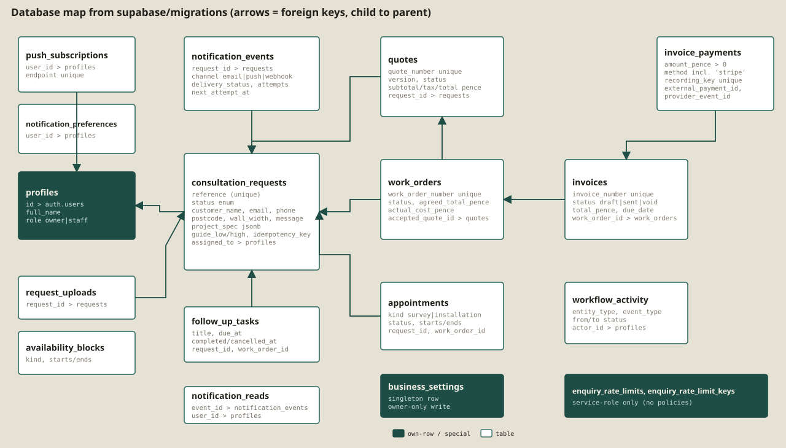
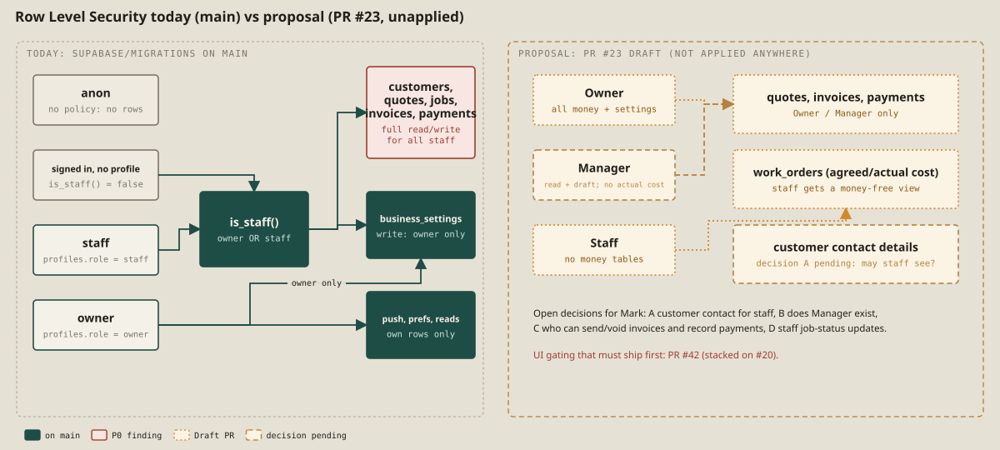

# 5b. Database (from `supabase/migrations/`)

Ten migrations, applied by hand according to the repository's own runbook; **the live schema state is not verified**. Eighteen tables and two views in `public`, all with Row Level Security enabled.

## Tables

| Table | Purpose | Introduced |
|---|---|---|
| `profiles` | One row per staff member; `role in ('owner','staff')`; id references `auth.users` | 20260906 |
| `consultation_requests` | The enquiry **and** the customer record (name, e-mail, phone, postcode, wall width, brief, project spec JSON, guide range, preferred window, source, staff notes, assignee, idempotency key, site-assessment flag) | 20260906 + later |
| `request_uploads`, `availability_blocks` | Photos metadata; blocked / holiday / available windows | 20260906 |
| `notification_events` | Outbox with retry bookkeeping | 20260906, 20261004, 20261006, 20261008 |
| `quotes`, `work_orders`, `appointments`, `follow_up_tasks`, `invoices`, `invoice_payments`, `workflow_activity`, `push_subscriptions` | The business workflow | 20261005 |
| `business_settings` | Singleton seller details | 20261009 (invoice settings) |
| `enquiry_rate_limits`, `enquiry_rate_limit_keys` | Public enquiry throttling (service role only) | 20261009 (rate limits) |
| `notification_preferences`, `notification_reads` | Per-user alert preferences and read marks | 20261016 |

Views: `invoice_balances` (paid, outstanding, overdue) and `work_order_financial_summary`, both `security_invoker` so they inherit the caller's RLS.

## Integrity rules enforced in the database

- **Money in integer pence**, currency fixed to GBP, tax as basis points with `tax_pence = round(subtotal * rate)` checked; `total_pence` is a generated column.
- **Status machines** by trigger `enforce_workflow_status_transition` for quotes, jobs, appointments and invoices (illegal jumps raise errors); an **accepted quote is locked**; a **job requires an accepted quote** for the same enquiry; a **sent invoice is locked** (only sent→void), **void is terminal**, an invoice **with payments cannot be voided**, and totals cannot drop below paid.
- **Payments**: amount > 0, **overpayment blocked** with a row lock, only `sent` invoices accept payments, `recording_key` unique (idempotency), `external_payment_id` and `provider_event_id` unique (provisioned for a future payment provider; nothing writes them).
- **Calendar**: an exclusion constraint (`exclude using gist` on the time range, `20261005…sql:76`) stops two active appointments overlapping; the trigger `prevent_calendar_overlap` (advisory-locked) stops an appointment over a `blocked`/`booked` window and a block over a scheduled or confirmed appointment.
- **Quote gate**: when `assessment_required`, a quote needs a completed survey (`enforce_quote_assessment_gate`).
- **Audit trail**: `log_workflow_record_update` writes `workflow_activity` rows.
- **Hardening**: all application `SECURITY DEFINER` functions use an empty `search_path` (migration 20261007; asserted by a test).
- **Identifiers**: quote, job and invoice numbers are `text unique`, generated **by the browser** (see M4/M5/M8).

## Row Level Security today

`is_staff()` is true for any profile with role `owner` or `staff`. Nearly every table's policy is `using (public.is_staff())`, so **any staff account can read and write customers, quotes, jobs, invoices and payments** (finding P0, issue #9). Exceptions: `business_settings` write is owner-only; push subscriptions, preferences and read marks are own-row only; the rate-limit tables have RLS and **no policy**, so only the service role can use them; `profiles` is readable by staff; storage `project-uploads` is staff-read.

## Scripts that are not migrations

`supabase/schedule_notification_retries.sql`, `schedule_enquiry_rate_limit_cleanup.sql`, `audit_remote_schema.sql`, `audit_public_enquiry_retention.sql`: operator scripts for the owner to run deliberately in the Supabase SQL editor. The audit scripts are for **inspecting** the live project; they were **not run** for this book.

## Not in `main` (Draft PRs)

| Draft | What it would change | State |
|---|---|---|
| PR #23 | Least-privilege role model (Owner/Manager/Staff), money-free job view, security_invoker views | SQL kept in `supabase/drafts/…_DRAFT.sql` ("DO NOT APPLY"); tests incl. real RLS on throwaway PGlite pass |
| PR #41 | Server-side sequences for quote, job and invoice numbers | draft SQL, unapplied |
| PR #43 | Append-only payment reversals | draft SQL, unapplied |
| PR #22 | Retry cap and dead-letter state | draft SQL, unapplied |

**Order matters:** the permissions draft must not be applied before the app is updated (PR #42), or staff will lose the money panels.

*Evidence: E-17, E-28, E-29, E-30, E-33, E-35, E-41 to E-50.*
