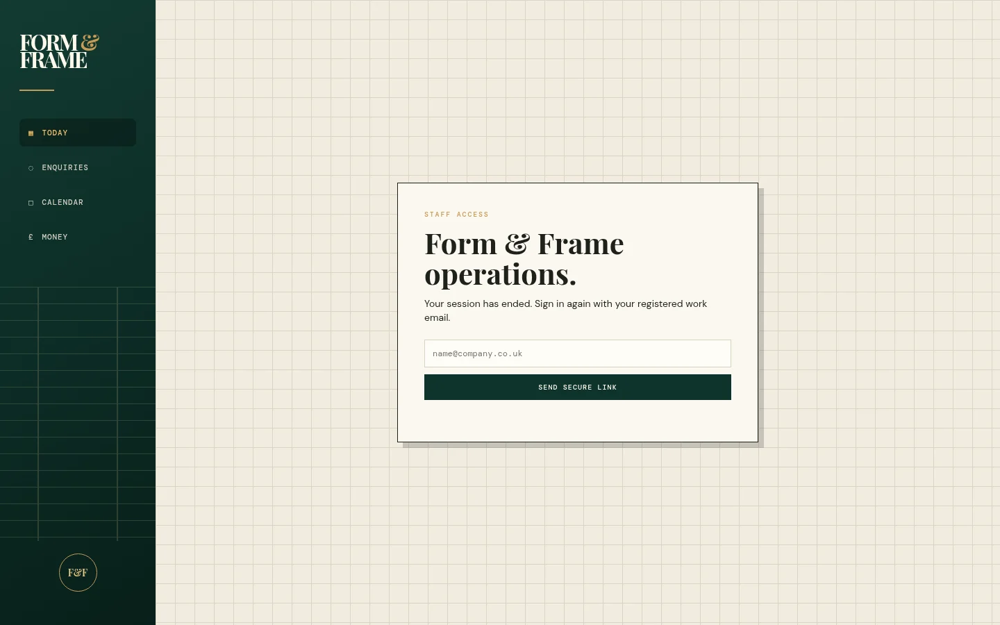
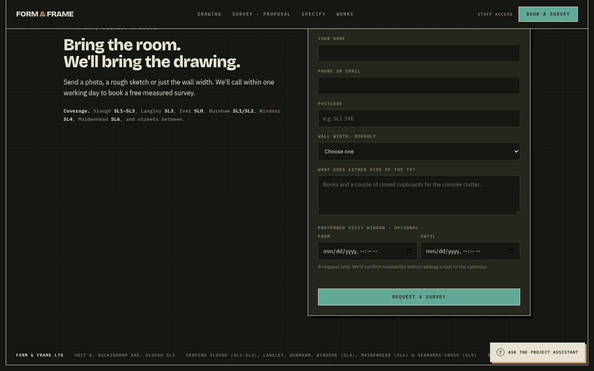
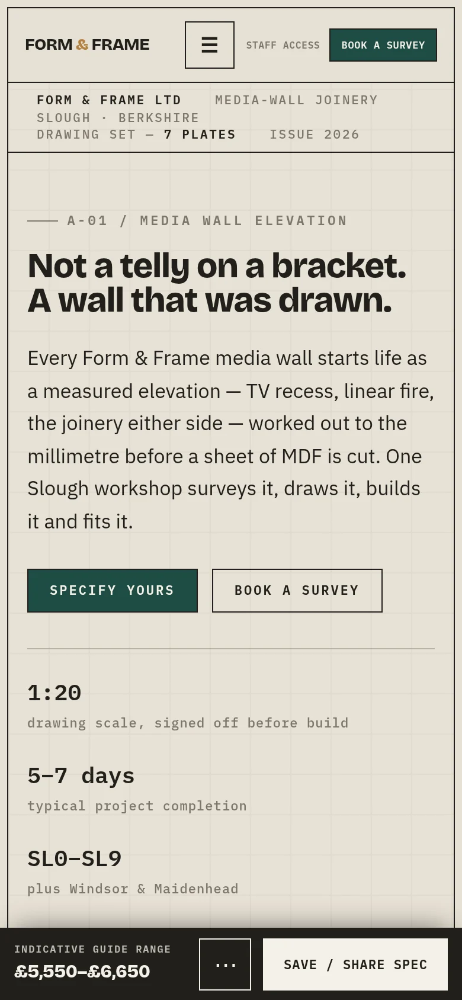

# 1. Identity and design system

Everything here is read from the code at `31a08f6`: colours and fonts from the CSS custom properties, components from the class rules. Nothing is invented. The most important finding: **the repository contains two visual languages**, one for the public site and one for the staff app, and they share a brand mark but not tokens or fonts.

## 1.1 Brand mark and logo

- **Public wordmark**: text `FORM & FRAME` in Bricolage Grotesque 800 at 19 px, with the ampersand in oak (`.mark b{color:var(--oak)}`, `index.html:138-139`). No image logo file exists for the public site. [E-24]
- **Staff wordmark**: stacked `FORM & FRAME` in Playfair Display 700 at 31 px, ampersand in gold (`operations/styles.css`, `.brand`). A round **F&F** monogram badge (55 px circle, gold border) sits at the bottom of the sidebar. [E-25]
- **App icon** (`operations/icon.svg`): a 512 px rounded square `#0e342c` containing a cream (`#f1ecdf`) shelving frame with a gold (`#c99b55`) centre bar. Raster variants: `icon-180.png`, `icon-192.png`, `icon-512.png`, `icon-maskable-192.png`, `icon-maskable-512.png`. [E-27]
- **Notification badge**: monochrome `FF` mark, `notification-badge-ff.png` and `notification-badge-ff-192.png`. [E-27]

## 1.2 Colour: public website (`index.html:21-56`)

::: swatches
Paper|#E6E1D5|page background (drafting-paper putty)
Paper 2|#EEEADF|alternate surface
Paper 3|#F4F1E8|cards, forms, nav button text
Frame|#211F1A|text, borders, shadows (graphite)
Ink|#1E4D45|primary action, links, focus ring (workshop green)
Ink 2|#2E6A5E|secondary green
Oak|#B4823F|accent, ampersand, step numbers (oak timber)
Pencil|#7C766A|secondary text
Pencil 2|#B8B2A2|grid lines, hairlines
Glow|#D2892A|warm-light semantic only (amber)
Bad|#9E3B2C|error and validation
:::

A dark theme exists and follows `prefers-color-scheme: dark` (or `data-theme="dark"`): paper `#16160F`, paper 2 `#1E1E16`, paper 3 `#26251C`, frame `#E7E2D5`, ink `#63A997`, ink 2 `#83C7B4`, oak `#CE9C5F`, pencil `#8C8577`, pencil 2 `#3B3A30`, glow `#E7A63F`, bad `#D8705E`. Observed rendering of the dark theme:

## 1.3 Colour: staff app (`operations/styles.css`)

::: swatches
Paper|#F1ECDF|app background
Card|#FBF8F0|panels and cards
Ink|#1D211C|text
Green|#0E342C|sidebar, primary buttons, headings (gradient #123B32 to #071F1A in the sidebar)
Gold|#C99B55|accent, new-enquiry status, "next step" border
Line|#D9D1BF|hairlines
Muted|#766F63|secondary text
Red|#A84137|blocked, errors
:::

Status colours (workflow badges): new `#c99b55`, opened `#0e342c`, quoted `#2d4a5c`, accepted `#2f7d4f`, in progress `#a8531c`, completed `#0e342c`, archived `#766f63`. Notice banners: error `#b84f42` border on `#fff1ed`, success `#6f9877` on `#edf6ec`, warning `#c99b55` on `#fff7e7`.

## 1.4 Typography

| Role | Public site | Staff app |
|---|---|---|
| Headings | **Bricolage Grotesque** 800, tight tracking (`-.02em`), line-height 1.02, balanced wrapping | **Playfair Display** 600/700 serif |
| Body | **IBM Plex Sans** 400, 16 px/1.62 | **DM Sans** 400-600, 14 px/1.45 |
| Labels, buttons, data | **IBM Plex Mono** 500-600, 10-11 px, uppercase, letter-spacing .09-.16em | **DM Mono** 400-500, 9-11 px, uppercase |

Both sites load their web fonts from `fonts.googleapis.com` (`index.html:15`, `operations/index.html:15`). [E-24] This is a third-party request at page load and an item for the CSP work (see [Security](security.md)). **For this book**, the fonts are installed locally on the build machine, so the PDF uses the real brand fonts for the public brand (Bricolage Grotesque, IBM Plex Sans/Mono); the book's own chrome uses the public-site tokens. The Live Master references the same families without loading them from the network and falls back to system fonts on machines that do not have them installed.

## 1.5 Components (public site)

| Component | Rule (from CSS) |
|---|---|
| Button `.btn` | Square corners (`border-radius:0`), 1 px frame border, Ink fill, Paper 3 text, IBM Plex Mono 11 px uppercase, `.14em` tracking, padding 12x18. Hover lifts 1 px with a 3 px hard shadow; active presses down. `.btn.ghost` is transparent; `.btn.sm` 9x12 padding; disabled at 40% opacity. (`index.html:145-157, 277`) |
| Sheet frame `.sheet` | 1 px frame border, 14 px margin, a 34 px drafting grid built from two linear gradients in Pencil 2. |
| Plate `.plate` | Section wrapper, 72 px vertical padding, 1 px frame bottom rule. Sections are titled "A-01" to "A-07" like drawing plates. |
| Content width `.wrap` | max-width 1180 px, 24 px side padding; `.prose` 58ch. |
| Eyebrow `.eyebrow` | Mono label preceded by a 26 px hairline. |
| Card styles | `.work`, `.step`, `.testimonial`, `.form`: 1 px frame border on Paper 3 with a **hard offset shadow** (4 px or 6 px, `var(--shadow)` = `rgba(33,31,26,.16)`), no blur and no radius. |
| Form `.form` | Paper 3, 24 px padding, 6 px hard shadow; rows with 16 px bottom margin; labels mono uppercase; error text in Bad colour; honeypot field hidden. |
| Chip `.chip` | Square selection tiles in the configurator, focus ring 2 px Ink at 3 px offset, disabled 32% opacity. |
| Focus | Global `:focus-visible{outline:2px solid var(--ink);outline-offset:3px}`. |

Spacing is not a token scale; values are literal (4, 6, 8, 12, 14, 16, 18, 20, 24, 26, 34, 72 px recur). Borders are always 1 px solid frame; shadows are always hard offsets. Motion is limited to 120 ms transforms and is disabled by `@media (prefers-reduced-motion:reduce)` (`index.html:659`).

## 1.6 Components (staff app)

Rounded 12 px cards (`border-radius:12px`) on `#fbf8f0` with a soft shadow `0 5px 16px rgba(28,41,34,.06)`, and the "Today" and "Business" panels use a 1 px translucent ink border with a 4 px hard shadow. Status pills are 999 px radius mono badges. Primary buttons (`.ws-primary`) are `#0e342c` with `#fff8ea` text, 9 px radius, 44 px minimum height. The workspace uses a 10-step stepper and a gold-bordered "Next step" card. A fixed bottom navigation bar with four items (Today, Work, Calendar, Money) appears under 760 px.

## 1.7 Responsive rules

| Surface | Breakpoints in the CSS |
|---|---|
| Public site | `max-width:900px` (navigation collapses to a toggle, multi-column grids stack), `max-width:560px` (visit-window fields stack), `min-width:901px` (configurator side-by-side), `hover:none` (touch adjustments), `prefers-reduced-motion`, `prefers-color-scheme` |
| Staff app | `max-width:1120px` (metrics 6 to 3 columns, Today columns stack), `max-width:900px`, `max-width:760px` (sidebar becomes a top bar, bottom nav appears, metrics 2 columns, cards single column, notification panel full width) |

## 1.8 Icons

There is no icon library. Navigation icons in the staff app are Unicode glyphs (▦ ◌ □ £, ⌂ ▤), the bell is an emoji, and the configurator draws its elevation as inline SVG generated in JavaScript. [E-25]

## 1.9 Observations for the designer

- Two palettes and two font stacks (green `#1E4D45` vs `#0E342C`, oak `#B4823F` vs gold `#C99B55`, Bricolage/Plex vs Playfair/DM). Unifying them is a decision for the owner; this book documents both as built.
- The public tokens carry a full dark theme; the staff app has none.
- The public site has no image logo, so a favicon and social image rely on `operations/icon.svg` and a project photo (see [Website](website.md)).
