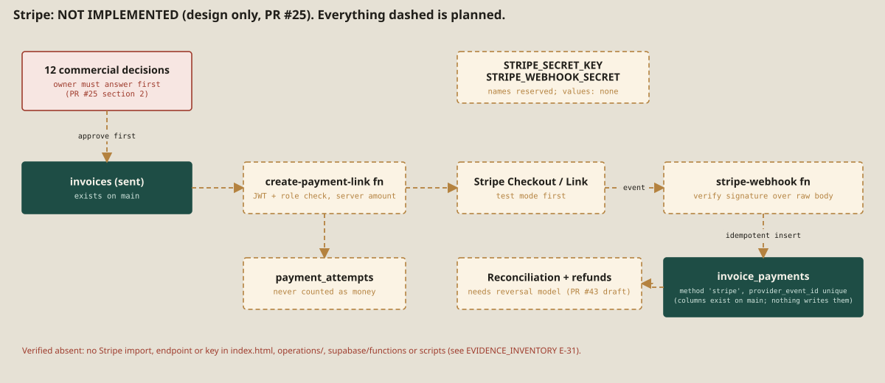

# 5c. Integrations

| Integration | Used for | Where in the code | Status | Notes |
|---|---|---|---|---|
| **Supabase** (Auth, Postgres/PostgREST, Realtime, Storage, Edge Functions, Cron, Vault) | Entire backend | `operations/app.js`, `index.html` form, `supabase/` | [[IMPLEMENTED]] | Project ref pinned in `scripts/public-config.mjs` and `supabase/config.toml`. Live state not verified. |
| **Vercel** | Static hosting, build (`node scripts/build-public.mjs`) | `vercel.json` | [[IMPLEMENTED]] | Preview and Production state not verified. The public site's "Staff access" link points to `form-and-frame.vercel.app`. |
| **GitHub Actions** | CI (`quality.yml`) | `.github/workflows/quality.yml` | [[VERIFIED]] | The same steps were replayed locally on Node 24 for this book (all passed); the GitHub-hosted run itself was not triggered by this work. |
| **Resend** | Owner alert e-mail on a new enquiry (and retries) | `submit-enquiry`, `retry-notifications` | [[IMPLEMENTED]] | Only if `RESEND_API_KEY`, `NOTIFICATION_EMAIL`, `NOTIFICATION_FROM` are set. Real delivery not verified; sending domain not confirmed (pending Mark). |
| **Web Push (VAPID)** | Phone/desktop alerts | `push-new-enquiry`, `service-worker.js`, `push-support.mjs` | [[IMPLEMENTED]] | Needs `VAPID_*` secrets and a device subscription. Real device receipt not verified here. |
| **esm.sh** | Loads `@supabase/supabase-js@2.117.2` in the staff app and Edge Functions | `operations/app.js:1`, `*/index.ts` | [[IMPLEMENTED]] | Runtime dependency on a third-party CDN without integrity check (issues #10/#11; Draft PR #27 vendors it). |
| **Google Fonts** | Web fonts | `index.html:15`, `operations/index.html:15` | [[IMPLEMENTED]] | Third-party request. |
| **Stripe** | Online payments | none | [[NOT IMPLEMENTED]] | See below. |
| **E-mail to customers / SMS / WhatsApp** | Customer messaging | none | [[NOT IMPLEMENTED]] | The app states "No email was sent" after quote/invoice status changes. |
| **AI / language model** | Project assistant | none | [[NOT IMPLEMENTED]] | The assistant is rule-based and local. |
| **Analytics / tracking** | none found | none | [[NOT IMPLEMENTED]] | No analytics script in `index.html`. |

## Stripe: absent, shown as planned

A repository-wide search for "stripe" over code (`.mjs`, `.js`, `.ts`, `.html`, `.sql`, `.toml`, `.json`, `.yml`) finds only: the `stripe` value allowed in the `invoice_payments.method` check and its two provider-id columns, a UI test fixture string, and the prebuilt `docs/MASTER_DOCUMENTATION.html`; Markdown mentions are in `OPERATIONS_HUB.md`, `OVERNIGHT_OPERATIONS_HANDOFF.md` and `supabase/ACTIVATION_RUNBOOK.md`. **There is no Stripe library, key, endpoint, webhook or checkout code.** [E-17] Draft PR #25 holds a design document and a test that fails if Stripe code appears; it lists **12 commercial decisions** that only the owner can make (does the customer pay online, deposits, payment methods, VAT, refunds, who holds the Stripe account…). No implementation should start before those answers.

## Pending configuration (Mark, 19 October 2026)

| Item | State |
|---|---|
| Stripe account, keys and webhook | Pending, configured by Mark on 19 Oct (not verified). Nothing is implemented in code; values are never recorded in this book. |
| Production domain | Pending, configured by Mark on 19 Oct (not verified). |
| Professional business e-mail (also the future Resend sender and notification address) | Pending, configured by Mark on 19 Oct (not verified). |
