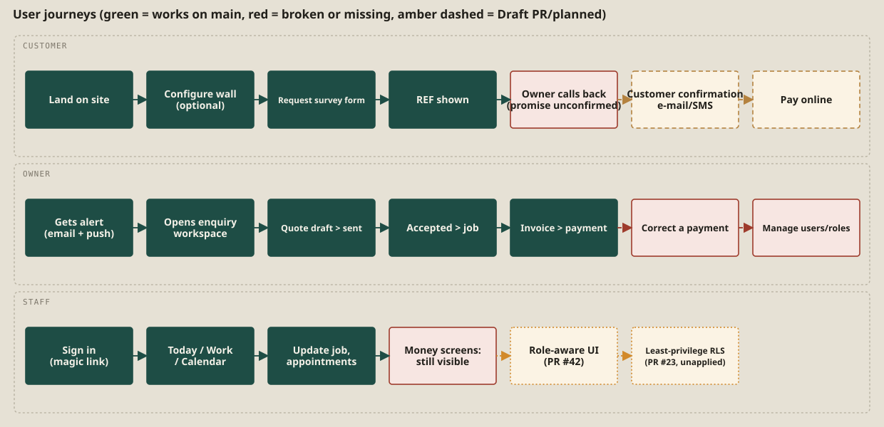

# 6. User journeys

## 6.1 Customer

| Step | What happens | Outcome | Status |
|---|---|---|---|
| 1. Land on the site | Hero, navigation, title strip. | Understands the offer. | Works. Claims in the copy are unconfirmed (pending Mark). |
| 2. Configure a wall (optional) | Sets wall, bays, finish; sees a live guide range; may save the spec locally or send it with the survey. | A guide price in the browser; spec copied into the brief. | Works; pricing logic untested. |
| 3. Request a survey | Fills name, phone or e-mail, postcode, width, brief; optional visit window; submits. | `REF FF-…` is shown; the enquiry is saved; the owner gets an alert. | Implemented and unit-tested; **live path not observed**. |
| 4. Confirmation to the customer | None is sent. The page shows the reference only. | The customer has no copy of the enquiry and no way to contact the business from the page. | **Missing** (no e-mail/SMS; no phone or e-mail is published). |
| 5. Callback | The page promises a call "within one working day". | Depends on the owner; the promise is not confirmed by the owner. | **Unconfirmed claim.** |
| 6. Quote, acceptance, payment | Handled offline: the owner sends the quote outside the app. Online acceptance and payment do not exist. | Customer pays by other means. | **Missing** (Stripe not implemented). |

Decisions on the way: a customer may skip the configurator; may enter a phone or an e-mail (one field); may propose a visit window, which is only a request. Failure paths: validation messages inline; 429 "Please wait about N minutes"; timeout message after 30 s with duplicate protection.

## 6.2 Owner

| Step | What happens | Status |
|---|---|---|
| 1. Alert | E-mail to the internal address (if Resend is configured) and Web Push to enrolled devices; an entry in the notification centre. | Implemented; real delivery not verified. |
| 2. Sign in | E-mail magic link; role is checked. | Implemented; live link/redirects not verified. |
| 3. Open the enquiry | The workspace shows the next action; the enquiry moves from New to Opened. | Verified in demo and by tests. |
| 4. Survey / assessment | Optionally require a site assessment; schedule a survey appointment (conflict-checked); mark it completed. | Implemented. |
| 5. Quote | Create a draft (scope, subtotal, explicit tax), mark sent (no e-mail goes out), then accepted. | Implemented; a **sent quote has to be e-mailed manually**. |
| 6. Job | Convert the accepted quote into a job; step it through to completed. | Implemented. |
| 7. Invoice and payment | Draft invoice from the job, mark sent, record payments manually. | Implemented; invoice and payment numbers/records are browser-driven. |
| 8. Correct a mistake | A wrongly recorded payment **cannot be corrected in the app**. | **Broken / missing** (#14, PR #43). |
| 9. Manage the team | Add a staff member, change a role. | **Missing**: roles are set directly in the database (#31). |
| 10. Report | Five headline figures only. | **Partial** (#33). |

## 6.3 Staff

| Step | What happens | Status |
|---|---|---|
| 1. Sign in | Same magic link; the account must have a `profiles` row. | Implemented. |
| 2. Daily work | Today, Work, Calendar tabs; update appointments, follow-ups, job status. | Implemented. |
| 3. Money screens | **Any staff account can see quotes, invoices, payments, agreed totals and actual job costs, and can record payments.** | **Broken (P0 #9, #28).** Fix proposed in PR #42 (UI) and PR #23 (RLS), neither merged or applied. |
| 4. Customer contact details | Visible to staff; whether they should be is decision A. | Pending Mark. |

*Evidence: E-05, E-06, E-08, E-09, E-11, E-14, E-15, E-17, E-34.*
