# 4. Owner Dashboard (staff app, `/operations/`)

The Owner Desk is a mobile-first staff PWA: `operations/index.html`, `app.js` (1,386 lines) and 21 small ES modules; all but one (`notification-view.mjs`) have a test file. It shows business records only after a verified Supabase sign-in; without a configuration it falls back to a **demo mode**.

::: demo
**DEMO MODE — fictional data, not production.** Every staff-app screenshot in this chapter was captured from the app's built-in demo mode (the page served from `operations/` with no `config.js`, so `window.FF_OPERATIONS_CONFIG` is undefined and `startDemo()` runs, `operations/app.js:560,484`). The names (Amelia Grant, Hugo Clarke, Saira Patel), references (`FF-DEMO-10xx`), reserved example e-mail domains and sample figures are hard-coded fictional values; the tag "DEMO DATA" is visible in the header. The demo never saves records and shows no financial data. All live Supabase requests were blocked while capturing.
:::

::: warn
**Screens that need a real sign-in are marked "NOT VERIFIABLE" and are not mocked.** The quote editor results, jobs list, invoice and payment lists, finance totals, activity log, seller-details form and notification inbox all render only from live Supabase rows. Their logic is covered by unit tests (named per module) but the rendered screens were **not observed** for this book.
:::

## 4.0 Modules at a glance

| # | Module | Where | Status on `main` |
|---|---|---|---|
| M1 | Today | Sidebar "Today" / phone tab | [[VERIFIED]] (demo observed; logic tests) |
| M2 | Enquiries (Work) | "Enquiries" / "Work" | [[VERIFIED]] (demo observed; tests) |
| M3 | Enquiry workspace (10-step flow) | opens from an enquiry | [[VERIFIED]] (demo observed; tests) |
| M4 | Quotes | workspace + Money | [[IMPLEMENTED]] |
| M5 | Jobs (work orders) | workspace + Money | [[IMPLEMENTED]] |
| M6 | Calendar and availability | "Calendar" | [[VERIFIED]] (demo observed; tests) |
| M7 | Appointments and follow-ups | workspace, Today | [[IMPLEMENTED]] |
| M8 | Invoices | Money | [[IMPLEMENTED]] |
| M9 | Payments (manual recording) | Money | [[IMPLEMENTED]] |
| M10 | Money / finance strip | "Money" | [[PARTIAL]] (totals only) |
| M11 | Business settings (seller details) | Money, owner only | [[IMPLEMENTED]] |
| M12 | Notification centre and push | Alerts bell | [[IMPLEMENTED]] |
| M13 | Activity history | Money, workspace | [[IMPLEMENTED]] |
| M14 | Roles and access | sign-in gate | [[PARTIAL]] |

Not present on `main` (do not read as features): a **Clients/customers module** (issue #32), **staff/user management** (#31), a **finance panel with ranges and exports** (#33), a **credit-note flow** (#34), **per-record activity with actor names** (#35), **business settings v2** (#37), a **printable quote** (#38), **quote expiry** (#39), **analytics** beyond the five figures in M10, and online payments. [[NOT IMPLEMENTED]]

## M1 Today

**Purpose.** What needs attention right now. **Data shown.** A recorded-money strip (invoiced, received, outstanding) for signed-in staff; six metric tiles (new enquiry, opened, visit requested, visit marked confirmed, quote sent, accepted job); "Today's plan" with six lists: enquiries received today, visit windows today, appointments today, replies due today, payment attention, delivery blockers. **Actions.** Open an enquiry from any row (each row shows its next action). **Backend.** Reads enquiries, appointments, follow-ups, invoices, jobs. **Permissions.** Owner and staff (money strip included: see [Security](security.md)). **States.** Loading; empty-state sentences for each list ("Booked appointments appear here once the business calendar is connected"); an error notice on failure. **Tests.** `today-view.test.mjs`, `pipeline.test.mjs`, `project-model.test.mjs`.

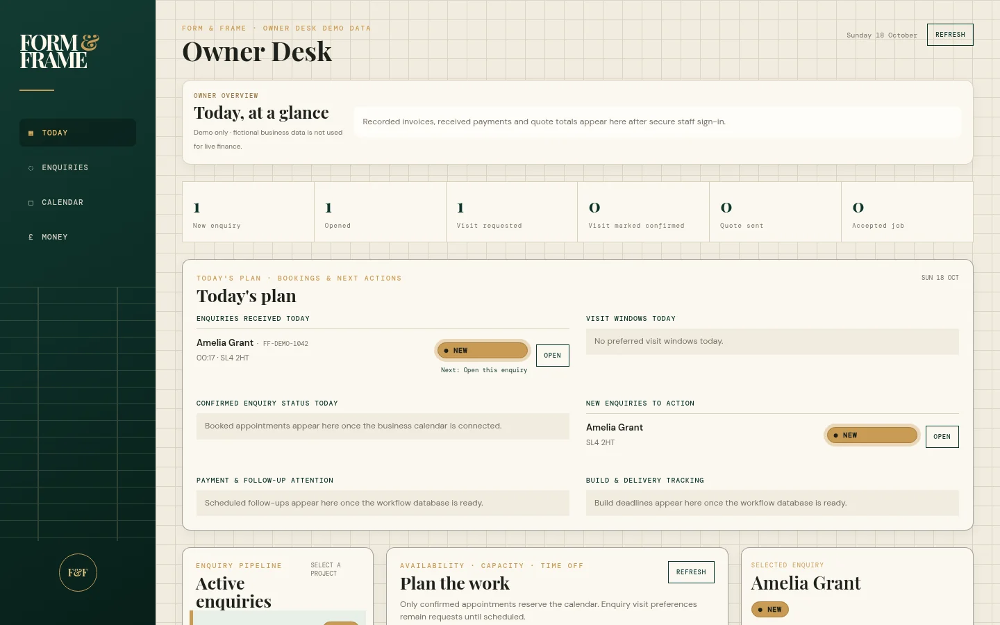

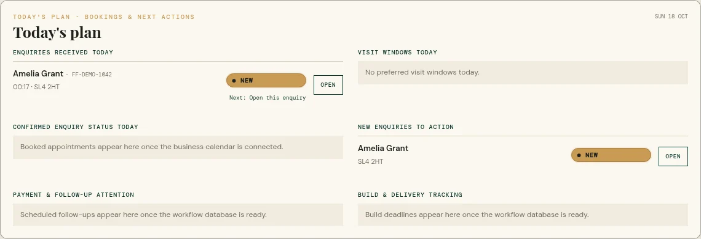

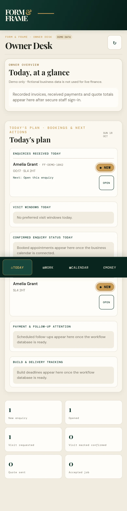

::: notverifiable
**Money strip with real figures: NOT VERIFIABLE.** In demo mode it reads "Recorded invoices, received payments and quote totals appear here after secure staff sign-in."
:::

## M2 Enquiries (Work)

**Purpose.** The pipeline of customer enquiries. **Data shown.** Each enquiry card: customer, reference, postcode, wall size, status pill, source, the website guide range, and the recommended next action; a "Selected enquiry" panel with an indicative project drawing (demo only: labelled "DEMO ONLY · FICTIONAL COST BREAKDOWN"). **Actions.** Open the workspace; edit customer details (live only); toggle "site assessment required". Status is advanced by workflow actions (quote sent/accepted, job steps), not by a free status selector. **Backend.** `consultation_requests` (select, update), realtime refresh. **Permissions.** Owner and staff. **States.** New enquiries are visually emphasised (left border, bold); unopened enquiries move to "Opened" when opened (`statusAfterOpen`). **Tests.** `enquiry-workspace.test.mjs`, `pipeline.test.mjs`, `assignment.test.mjs`.

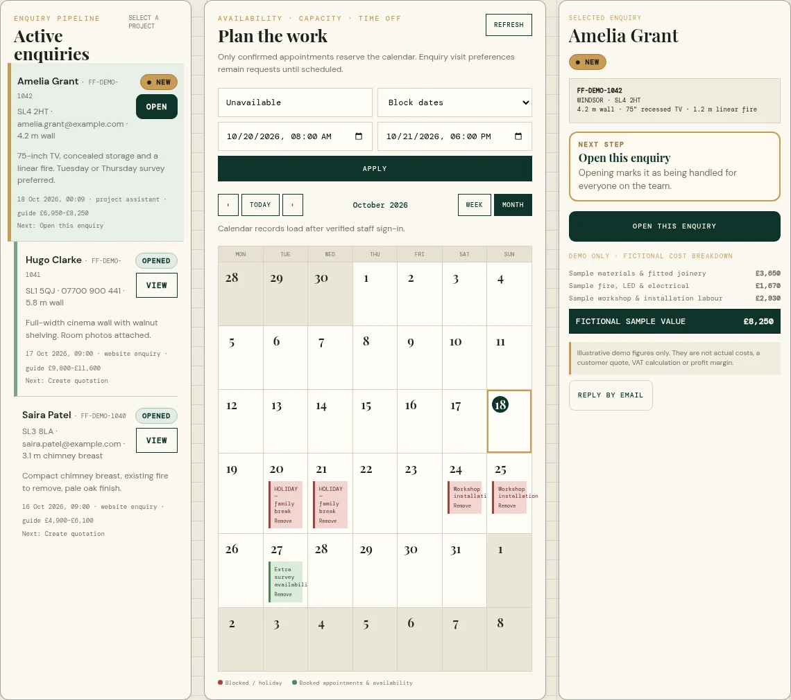

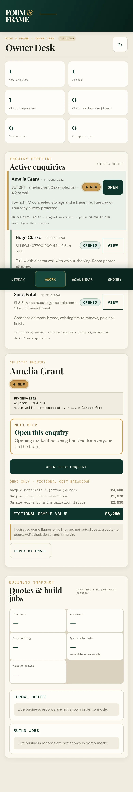

## M3 Enquiry workspace

**Purpose.** One page that walks an enquiry through the ten-step workflow and always shows the next action. **Flow.** New enquiry → Open → Prepare quotation → Send quotation → Customer accepts → Schedule survey / installation → Job in progress → Invoice → Payment → Completed (`WORKFLOW_STEPS`, `enquiry-workspace.mjs:16`). **Data shown.** Stepper; "Next step" card; Quotation, Appointments, Build job and Invoice & payment cards; Customer card with direct e-mail/phone actions; Requested media wall; photographs; activity. **Actions.** Whatever the next step is (for example **Create quotation**). **Permissions.** Owner and staff. **Tests.** `enquiry-workspace.test.mjs`, `enquiry-workspace-view.test.mjs`, `quote-readiness.test.mjs`.

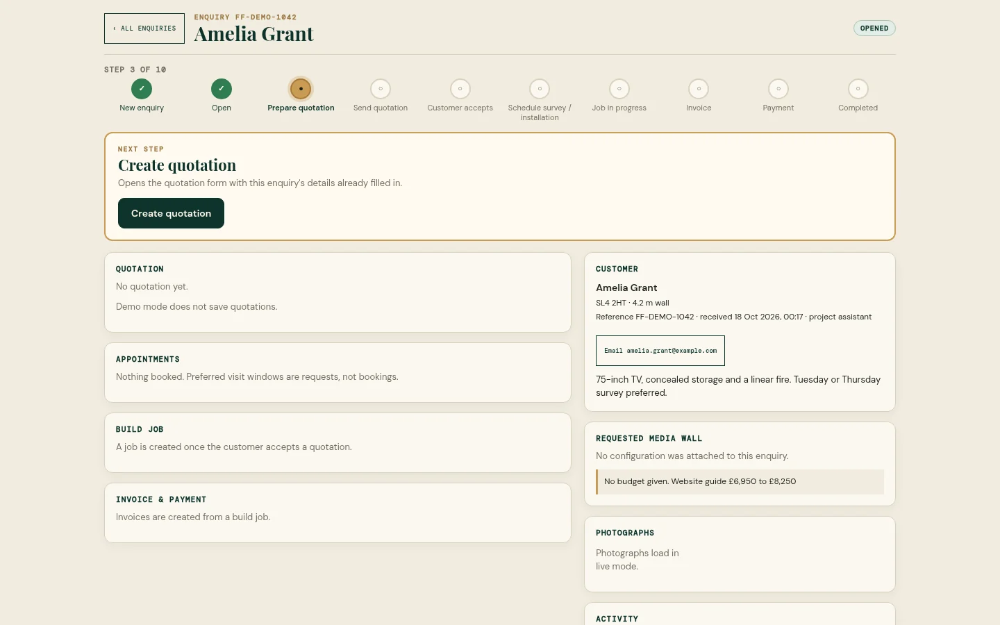

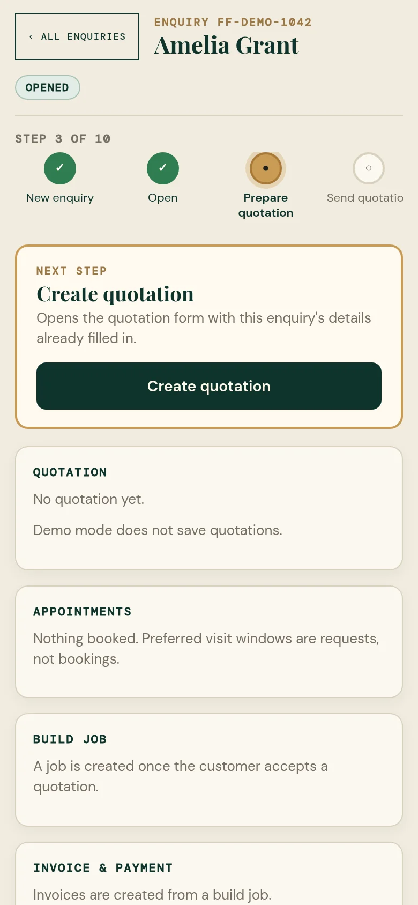

In demo mode the cards say "Demo mode does not save quotations", "Photographs load in live mode" and "Invoices are created from a build job."

## M4 Quotes

**Purpose.** Formal quotations, kept separate from the website guide price. **Flow.** Create draft (scope, subtotal in £, explicit tax rate %, valid-until) → mark **sent** → **accepted** / **rejected** / **expired** / **superseded**; accepting creates the right to convert into a job. **Rules enforced in code.** A quote cannot be issued until a required site assessment is completed (`canIssueQuote`); tax rate is explicit (no default); money is kept in integer pence; statuses follow a fixed transition table (`workflow.mjs`) mirrored by a database trigger; an accepted quote is locked by a trigger (`protect_accepted_quote`). Marking **sent** records the status only: **"No email was sent."** **Backend.** `quotes` insert/update; on sent/accepted the enquiry status becomes quoted/won. **Numbering.** The quote number `FFQ-YYYYMMDD-XXXX` is built **in the browser** from the date and four random characters (`app.js:1128`): uniqueness is by luck plus a unique constraint; draft fix in PR #41 (issue #15/#29). **Permissions.** Owner and staff (P0 finding: see Security). **Tests.** `workflow.test.mjs`, `quote-readiness.test.mjs`, `business-migration.test.mjs`. There is **no edit-quote form** (a new version is created instead).

::: notverifiable
**Quote editor with live data, quote list cards: NOT VERIFIABLE** (needs a signed-in staff session). Source: `operations/enquiry-workspace-view.mjs` (`quoteEditorHtml`), `app.js:183`.
:::

## M5 Jobs (work orders)

**Purpose.** Build jobs created from an accepted quote. **Flow.** accepted → ready to build / in progress → quality check → ready for install → installation scheduled → installed → completed (or cancelled); the UI offers only the next legal step and the database trigger rejects illegal jumps. **Data.** Agreed total (copied from the accepted quote), planned start, target completion, actual cost, assigned member. **Actions.** Convert accepted quote to job; advance status; plan build dates; record actual job costs. **Number.** `FFJ-YYYYMMDD-XXXX`, browser-generated (`app.js:1296`). **Permissions.** Owner and staff, including **actual cost** (P0 finding). **Tests.** `workflow.test.mjs`, `assignment.test.mjs`, `business-migration.test.mjs`.

## M6 Calendar and availability

**Purpose.** Plan the work; only saved, conflict-checked appointments reserve time ("A requested visit window is not a booking"). **Actions.** Month/week views with previous/next/today; add a block (Block dates, Holiday, Add availability); remove blocks; retry on load failure. **Backend.** `appointments`, `availability_blocks`; an exclusion constraint forbids overlapping active appointments and the trigger `prevent_calendar_overlap` forbids booking into blocked time (and blocks over reserved appointments). **Permissions.** Owner and staff. **Tests.** `calendar-records.test.mjs`, `availability-list.test.mjs`, `datetime-local.test.mjs`, `business-migration.test.mjs`.

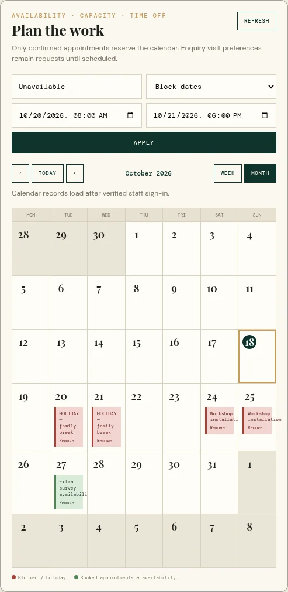

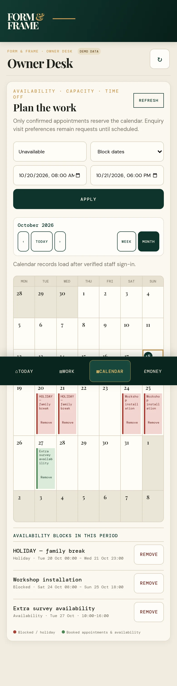

## M7 Appointments and follow-ups

Appointments (survey or installation; start/end; location; assignee) and follow-up tasks (title, due time) are created from the workspace and listed in Today. Saving an appointment sends **no customer message** (the form says so). Follow-ups can be completed. Tests: `calendar-records.test.mjs`, `assignment.test.mjs`. Status: [[IMPLEMENTED]].

## M8 Invoices

**Flow.** Create a **draft** from a build job (bill-to name, address, issue and due dates, subtotal and tax amount in £) → mark **sent** → may be **void** (only if no payments). Sent invoices are frozen by `protect_paid_invoice_balance`. A printable invoice document is rendered from the owner's seller details (`invoice-document.mjs`); it refuses to render until legal name, address and contact e-mail are set (`invoiceSettingsReady`). **Marking sent sends nothing.** **Number.** `FFI-YYYYMMDD-XXXX`, browser-generated (`app.js:1336`). **Tests.** `invoice-document.test.mjs`, `workflow.test.mjs`, `business-migration.test.mjs`.

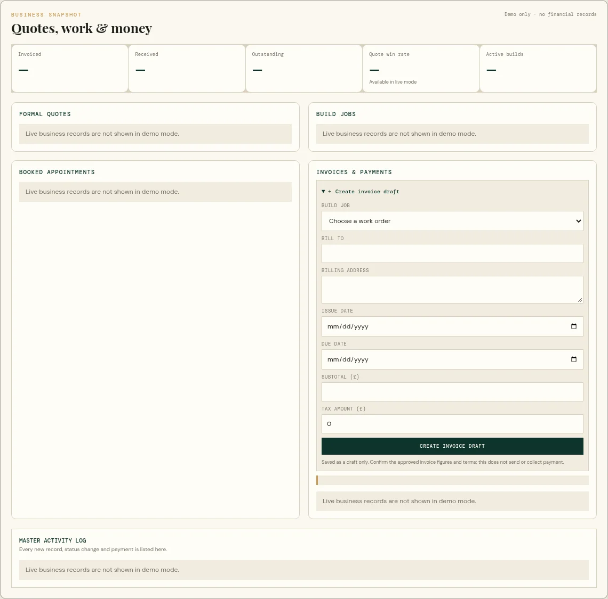

::: notverifiable
**Invoice list, invoice document and overdue flags with real rows: NOT VERIFIABLE.** Demo mode shows "Live business records are not shown in demo mode."
:::

## M9 Payments (manual recording only)

**Flow.** Record a payment against a **sent** invoice: amount in £ and method (`bank_transfer`, `card`, `cash`, `stripe`, `other`). The form generates an idempotency key held in `sessionStorage` per (invoice, amount, method), so a double-click or a retry after a lost response does not create a second payment (`payment-idempotency.mjs`). Database triggers lock the invoice row and **reject overpayment**. **Limits.** There is **no way to void, correct or reverse a payment** on `main` (issue #14, draft in PR #43). Choosing method `stripe` only labels a manual entry; **no Stripe integration exists**. **Permissions.** Owner and staff (P0 finding). **Tests.** `payment-idempotency.test.mjs`, `business-migration.test.mjs`.

## M10 Money panel and finance strip

Five figures (Invoiced, Received, Outstanding, Quote win rate, Active builds) plus quote, job, appointment, invoice lists. Computed by `buildFinanceSummary` (demo, fictional) and from `invoice_balances` (live). It is a snapshot only: no date range, ageing, export or profit (issue #33). Status: [[PARTIAL]].

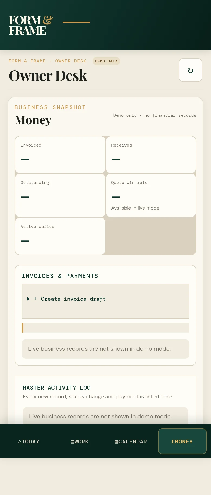

## M11 Business settings (seller details)

Owner-only form (`legal name`, billing address, company e-mail, phone, company number, VAT number, payment instructions, footer) in a singleton `business_settings` row. RLS: any staff may read, **only an owner may insert/update**. No tax, company or bank detail is pre-filled. The form is hidden for non-owner roles in the UI; RLS is the real control. Tests: `invoice-document.test.mjs`, `business-migration.test.mjs`. NOT VERIFIABLE on screen (owner login required).

## M12 Notification centre and push

**Purpose.** An in-app inbox of workflow and enquiry events plus device push. **Data.** `notification_events` (own team outbox), per-user read marks, per-user category preferences, push device state and install guidance (iOS needs the app installed to the home screen). **Actions.** Open the bell panel (Inbox / Settings & install), mark all read, set preferences, enable/disable push for this device, icon diagnostics. Opening a push notification deep-links to the enquiry (`push-target.mjs`). **Not shown in demo mode** (the bell is hidden), so **NOT VERIFIABLE** on screen. **Tests.** `notification-centre.test.mjs`, `push-support.test.mjs`, `push-target.test.mjs`, `service-worker.test.mjs`, `notification-badge.test.mjs`, `supabase/notification-centre-migration.test.mjs`.

::: notverifiable
**Notification inbox and settings panel: NOT VERIFIABLE** (bell hidden in demo; real data needs a login). Pure formatting and filtering logic is covered by tests.
:::

## M13 Activity history

An append-only `workflow_activity` table is written by database triggers on every status change and payment; the Money panel shows "Master activity log" (latest 30) and each enquiry workspace shows its own. Shown as actor id, not name (issue #35). Tests: `activity-label.test.mjs`, `business-migration.test.mjs`. NOT VERIFIABLE on screen.

## M14 Roles and access

`profiles.role` is `owner` or `staff`. After sign-in `checkStaffAccess` reads the role: no session → "Your session has ended"; signed in without a profile → "not been added to the Form & Frame team"; error → "We couldn't verify your staff access", business data stays hidden. Roles are assigned directly in the database (no UI). **Manager does not exist on `main`.** Owner-only: seller details. **Everything else is available to every staff account.** Draft PRs #23 (permission matrix + unapplied RLS draft) and #42 (role-aware money UI) address this: see [Security](security.md). Tests: `staff-access.test.mjs`.

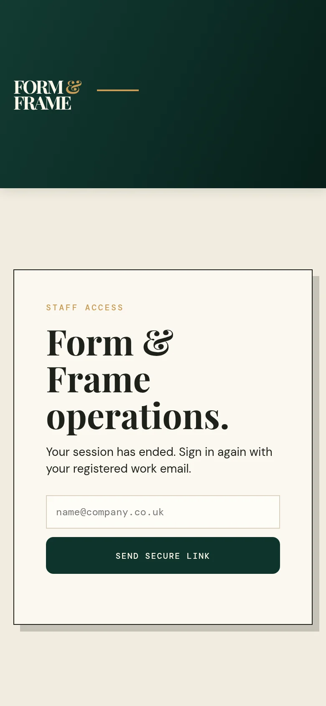

## State handling and errors (observed in code)

Every write goes through `saveLive`, which requires the saved row to be returned (`requirePersistedRow`) and otherwise shows an error banner; success banners say exactly what happened ("Quotation recorded as sent. No email was sent."). Destructive or irreversible status changes ask for `window.confirm` (not yet for all status selects: issue #30). A realtime subscription refreshes lists; if it fails, a warning asks the user to press Refresh.

*Evidence: E-09 to E-16, E-51 to E-55 and the stored test logs E-37 to E-40.*
