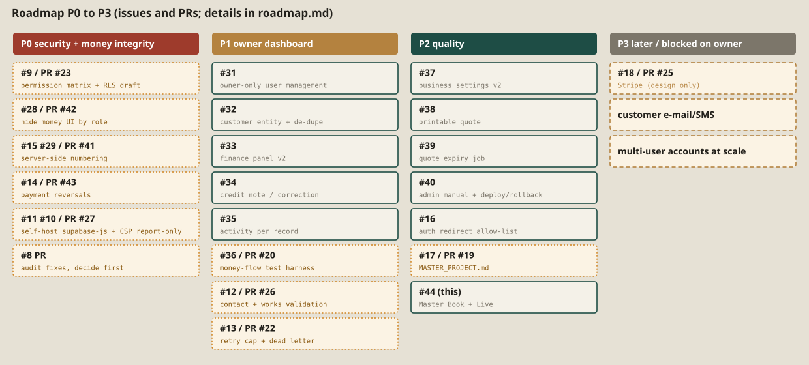

# 10. Roadmap

Titles starting `P0`, `P1`, `P2` are the issue's own label. Issues without one are placed by this book and marked *proposed*. All PRs below are Draft and unmerged. Nothing was merged, applied or deployed for this book.

## 10.1 P0 : before real money or more than one staff member

| Item | Issue | PR | State |
|---|---|---|---|
| Audit and restrict access to customer, quote, payment and financial data | #9 | #23 (RLS draft, unapplied) | Draft |
| Hide money UI from roles without access | #28 | #42 | Draft |
| Server-side numbering for quotes, jobs, invoices | #29 (extends #15) | #41 | Draft |
| Verify real contact details and "Completed works" with Mark *(proposed P0 for public trust)* | #12 | #26, #8 | Waiting for Mark |

## 10.2 P1

| Item | Issue | PR |
|---|---|---|
| Confirm-guard parity for status selects | #30 | |
| Owner-only user management (two equal Owners today; Manager role not needed for now) | #31 | |
| Customer entity and de-duplication | #32 | |
| Finance panel v2 | #33 | |
| Corrected invoice / credit note flow | #34 | |
| Activity history per record | #35 | |
| App flow test harness for money flows | #36 | #20 |
| CSP Report-Only *(proposed)* | #10 | #27, #8 |
| Self-host supabase-js *(proposed)* | #11 | #27 |
| Cap notification retries, dead-letter state *(proposed)* | #13 | #22 |
| Append-only payment reversals *(proposed)* | #14 | #43 |
| Verify magic-link redirect allow-list *(proposed)* | #16 | |

## 10.3 P2

| Item | Issue | PR |
|---|---|---|
| Business settings v2 | #37 | |
| Printable quote document and manual send record | #38 | |
| Quote expiry job | #39 | |
| Admin manual and deploy/rollback checklist | #40 | |

## 10.4 P3 *(proposed)*

| Item | Issue | PR |
|---|---|---|
| Stripe design and 12 commercial decisions (no implementation); Stripe config pending, configured by Mark on 19 Oct (not verified) | #18 | #25 |
| Master project document | #17 | #19 |
| Master Book and Live Master (this work) | #44 | |

## 10.5 Suggested order (FRAME recommendation, not a decision)

1. Decided 18 Oct: Thiago and Antonio are both Owners with identical access, no Manager role for now. Mark still answers A, C, D (permissions) and confirms the public content (#12). On 19 Oct Mark configures Stripe, the production domain and a professional business e-mail (pending, not verified).
2. PR #8 (audit hardening) first, then #27 and #26, which were rebuilt to be independent of it.
3. PR #20 (auth test harness), then #42 (role-aware UI).
4. Only after #42 is live: apply the permissions migration from #23.
5. #41 (numbering) and #43 (reversals), each with its migration reviewed, then #22 (retry cap).
6. P1 and P2 items; Stripe only after the commercial decisions in #25.

Merge and migration application stay with Mark; this book does neither.

*Evidence: issue and PR titles read from GitHub on 18 October 2026; Draft PR suites E-39, E-40.*
