# 3. Public website

Route `/` (`index.html`, 2,888 lines, inline CSS and JavaScript). Screenshots in this chapter are real captures of the **built** site (`node scripts/build-public.mjs` with the same fictional Supabase configuration CI uses) served locally and rendered in headless Chrome 155 at 1440 px (desktop) and 390 px (mobile, 2x pixel density). No request reached the live Supabase project (all `supabase.co` requests are blocked by the capture script). Fixed elements (sticky navigation, chat launcher) are hidden in the per-section crops and visible in the "fold" captures.

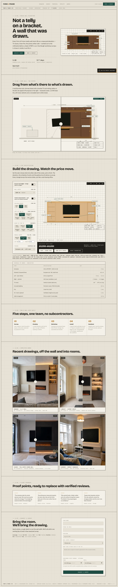

## 3.1 Navigation and title strip

Sticky navigation: wordmark; links DRAWING, SURVEY · PROPOSAL, SPECIFY, WORKS; a small **Staff access** link; a green **Book a survey** button. Under 900 px the links collapse behind a ☰ toggle. A title strip states "Form & Frame Ltd · Media-wall joinery · Slough · Berkshire · Drawing set — 7 plates · Issue 2026". Note: the nav has no link to Process, Testimonials or Request; "Book a survey" is the way to the form.

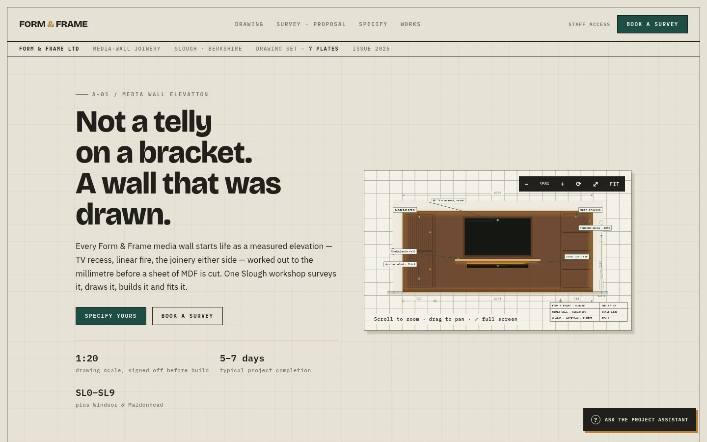

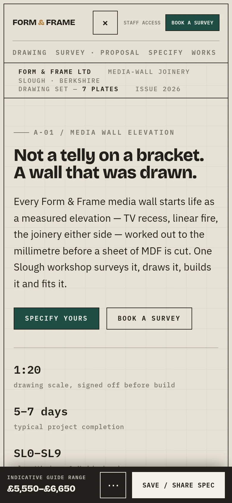

## 3.2 A-01 Hero: "Not a telly on a bracket."

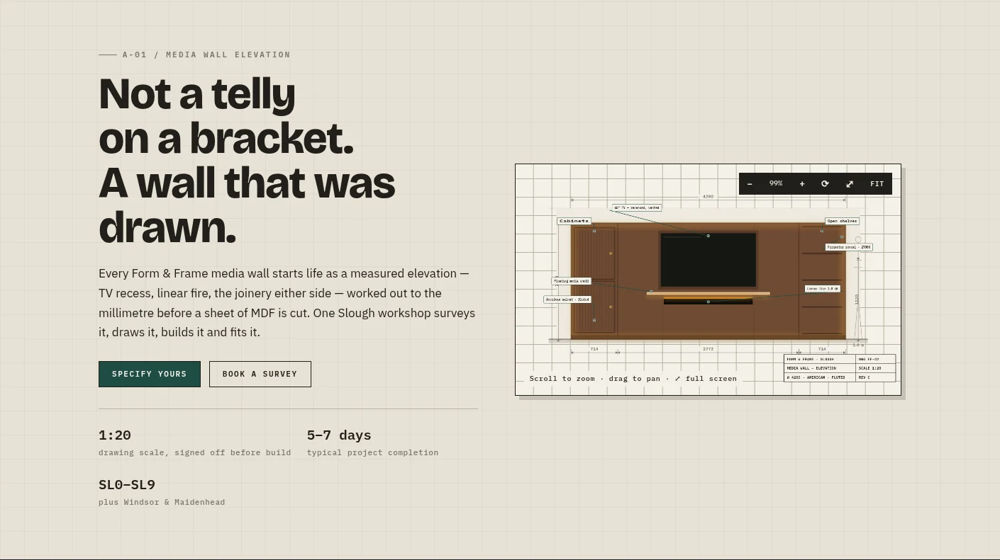

Interactive drawing of a media-wall elevation with zoom out/in, rotate, maximise and fit controls and "Scroll to zoom · drag to pan". Buttons: **Specify yours** (to `#specify`) and **Book a survey** (to `#request`). Three hero facts: "1:20 drawing scale, signed off before build", "5-7 days typical project completion", "SL0-SL9 plus Windsor & Maidenhead".

::: pending
**Pending Mark:** "5-7 days typical completion", "signed off before build", "One Slough workshop" and the postcode coverage are business claims in the code. Nothing in the repository proves them; the owner must confirm them before they are treated as fact.
:::

## 3.3 A-02 Survey vs proposal

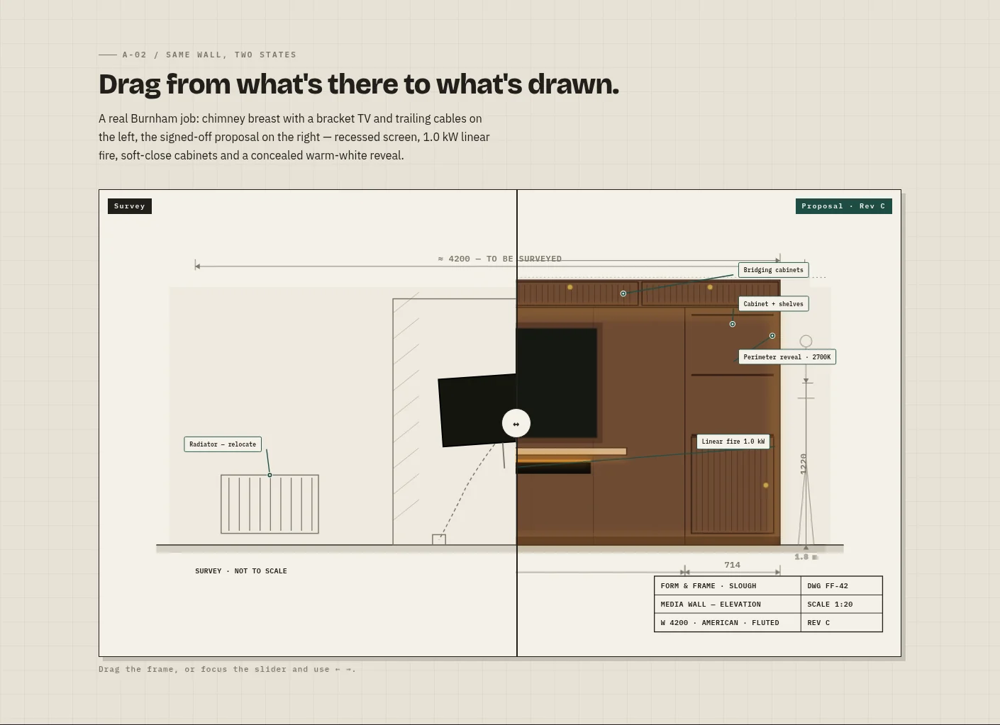

A draggable before/after slider ("Survey" vs "Proposal · Rev C"), also operable with the keyboard (range input with `aria-valuetext`). The copy says "A real Burnham job: chimney breast…", which is a claim about a real project: **pending Mark** (see 3.5).

## 3.4 A-03 Configurator "Build the drawing. Watch the price move."

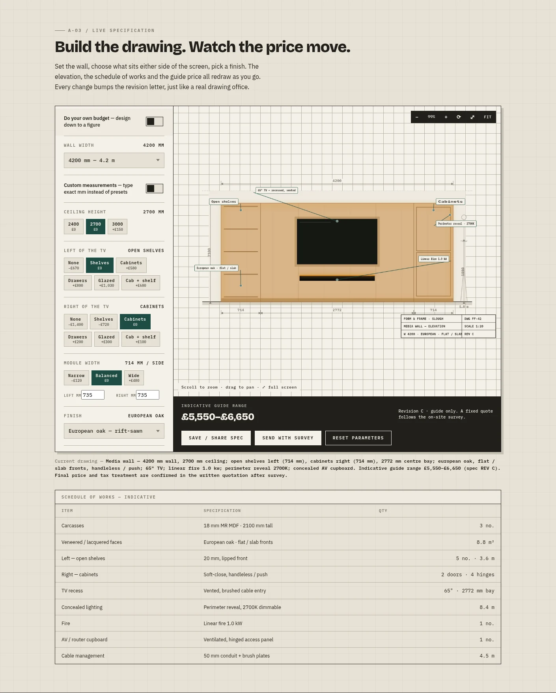

Browser-only. Controls: "Do your own budget" mode with a slider and **Fit spec to it**; wall width (3.0-6.0 m or custom); ceiling height 2400/2700/3000 or custom; left and right bays (None, Shelves, Cabinets, Drawers, Glazed, Cab + shelf) each with a price delta; module width; unit height; finish, surface texture, glass type, door & drawer front, handles; TV size; fire; light type; optional overlay on a room photo. The elevation, a "Schedule of works — indicative" table and an **Indicative guide range** (for example £5,550–£6,650 for the default) redraw live; every change bumps a revision letter. Buttons: **Save / share spec** (stored in `localStorage` key `ff_spec`), **Send with survey** (copies the spec into the form brief), **Reset parameters**. The page states the figure is a guide only: "A fixed quote follows the on-site survey."

::: note
The price logic is pure browser JavaScript inside `index.html`; **the guide prices are not covered by any automated test** (no test file touches `index.html` pricing). The guide-price range is saved with the enquiry as `guide_low`/`guide_high`. Formal quotes are separate records in the Owner Desk.
:::

## 3.5 A-04 Process and A-05 Completed works

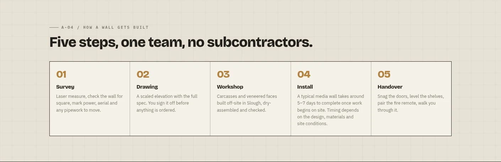

Five steps. The install step says "around 5-7 days … depends on the design, materials and site conditions".

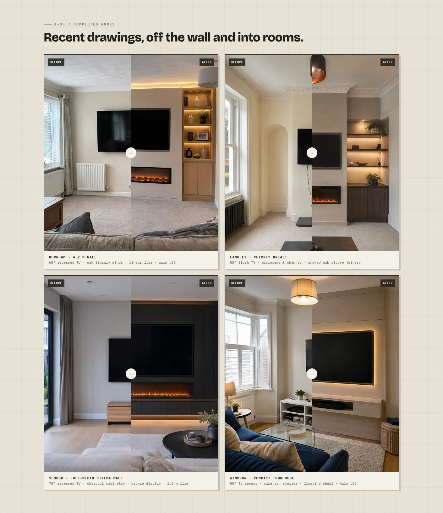

::: pending
**PLACEHOLDER / UNCONFIRMED CONTENT — pending Mark.** The four "Completed works" cases (Burnham, Langley, Slough, Windsor), their photographs (`assets/cases/*.webp`) and captions are presented on `main` as completed jobs, but no repository evidence shows they are real Form & Frame projects, or where the photographs came from. Draft PR #26 removes the section from the page (archived under `docs/pending-mark/` so it can be restored in one step) once the owner decides. Until then this book treats the section as **unvalidated**.
:::

## 3.6 A-06 Testimonials

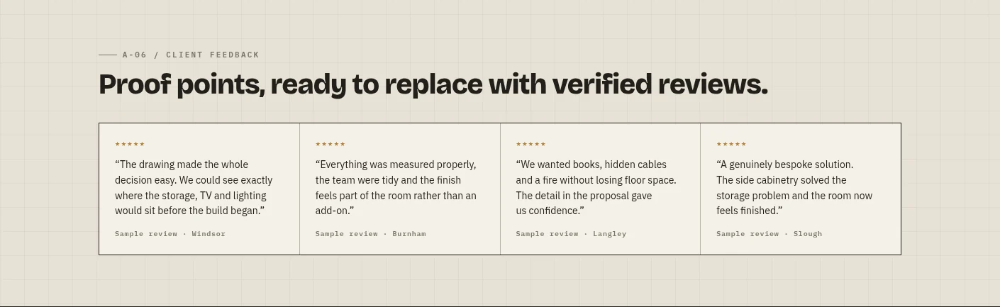

::: pending
**Placeholder content.** The heading reads "Proof points, ready to replace with verified reviews." and each card is captioned "Sample review · Windsor/Burnham/Langley/Slough" with five stars. These are **sample texts, not customer testimonials**; the page labels them as samples, but they are still publicly visible on `main`. PR #8 removes them; no real review exists in the repository. This book does not present them as testimonials.
:::

## 3.7 A-07 Contact, form and footer

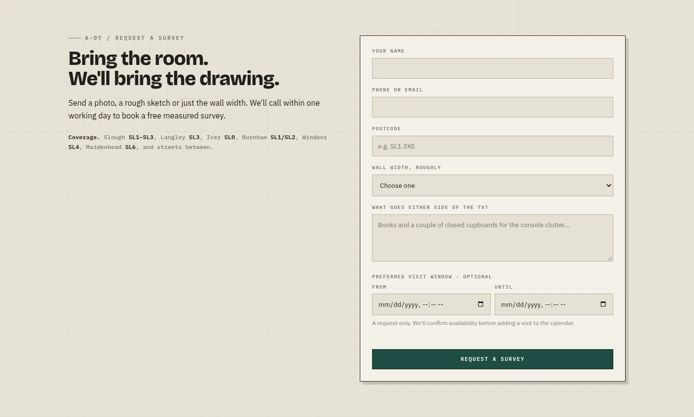

Form fields: Your name, Phone or email (one field; an `@` routes it to the email column, otherwise phone), Postcode, Wall width (4 options + "not sure"), brief ("What goes either side of the TV?"), optional preferred visit window (From/Until) and a hidden honeypot. Validation messages appear on submit:

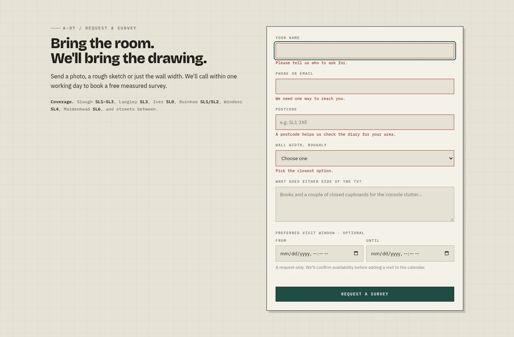

On success the form is replaced by "Thanks. We've received your enquiry." with a `REF` number. If the site was built without Supabase configuration, the form says "The enquiry form is being connected. Please contact us directly for now." (`index.html`, form handler): note that the page publishes **no phone number or e-mail address anywhere**, so there is nothing to "contact directly".

The submit sends `POST /functions/v1/submit-enquiry` with the public anon key, a client-generated idempotency UUID and the payload (name, email or phone, postcode, width, message, preferred window, project spec, guide range, `source: "website"`). Retry-safety, a 30-second timeout and 429 handling ("Please wait about N minutes") are implemented. [E-05] [E-06]

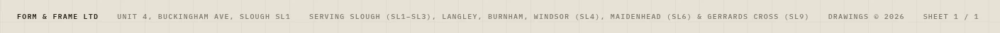

::: pending
**Pending Mark: contact facts.** The footer prints "Unit 4, Buckingham Ave, Slough SL1" and the contact copy promises "We'll call within one working day to book a free measured survey". Neither the address nor the free-survey / one-working-day promises can be verified from the repository. No phone number or e-mail is published; real contact fields are prepared only in Draft PR #26's pending file and are **not** to be published until confirmed.
:::

## 3.8 Project assistant

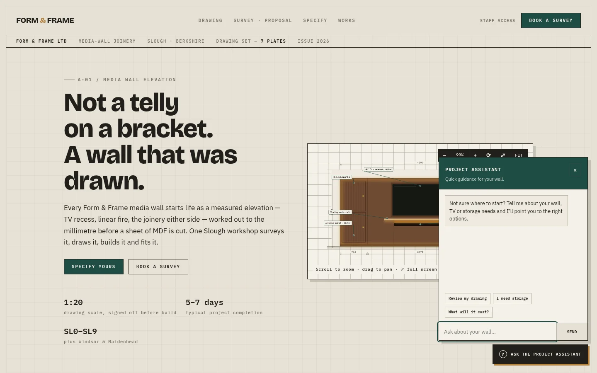

A floating **Ask the project assistant** launcher opens a chat panel with three suggestion chips (Review my drawing, I need storage, What will it cost?) and a text field. It is **rule-based and local**: the code contains no network call for it, and the repository's own handoff notes say there is no connected language model. [E-05] It can hand the configured spec to the form.

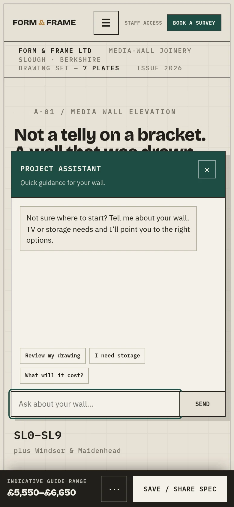

## 3.9 Mobile views of every section

| | |
|---|---|
| 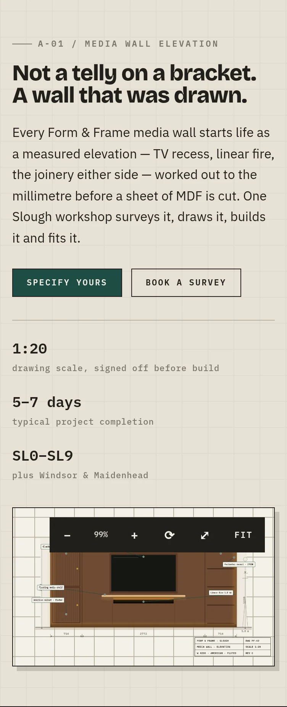 | 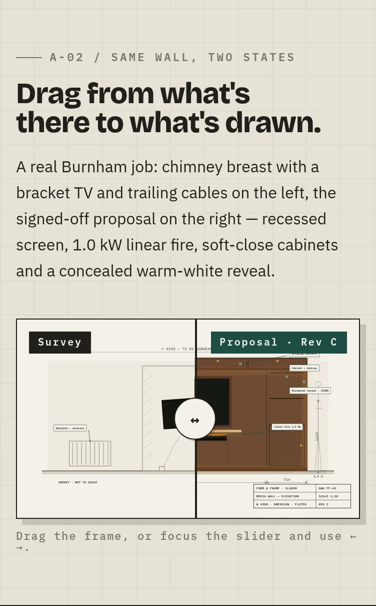 |
| 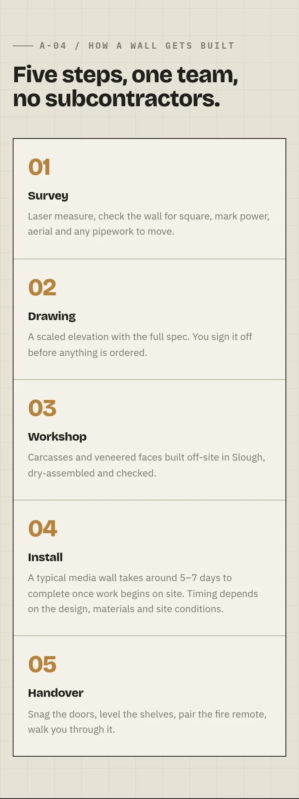 | 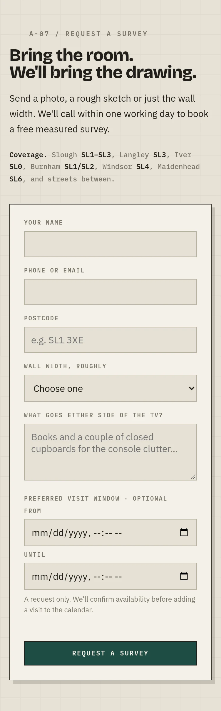 |

The configurator, works and testimonials mobile captures are in `assets/screenshots/public/sec-mobile-390-*.webp`.

## 3.10 Search, metadata and accessibility on `main`

- `<html lang="en-GB">`, a meta description, Open Graph title/description/type, and an `og:image` pointing at `burnham-library-after.webp` on a GitHub Pages URL; a `canonical` link to `https://mfm2712-droid.github.io/form-and-frame-media-walls2/`. JSON-LD `HomeAndConstructionBusiness` is present and publishes the street address and a `priceRange` of "£££" (both **pending Mark**). **No `robots.txt` or `sitemap.xml` on `main`** (added by PR #8). The canonical/OG host (GitHub Pages) differs from the staff-link host (`form-and-frame.vercel.app`): which one is the real public address is **pending Mark**. [E-04]
- Keyboard: global focus ring, slider keyboard operation, `aria-live` status on the form; reduced-motion support. No automated accessibility audit has been run on `main` (see [Testing](testing.md)).
- Performance: one 181 KB HTML file plus 436 KB of images; no performance measurement was taken for this book.

## 3.11 Public-site status summary

See the [Feature matrix](feature-matrix.md) for statuses. In short: the enquiry path is implemented and unit-tested; **Completed works, testimonials, address, free-survey and one-working-day claims are unvalidated owner content**; there is no legal text (privacy notice, terms) on the page.
